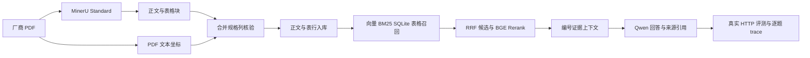

# Veriquery 落地记录与评测证据

本轮范围是器件规格书的文本与表格问答。验收覆盖原 PDF、上传、解析、分块、入库、召回、重排、生成、引用与应用重启。后续可以用本文复盘问题和核对简历素材。



## 难点、根因与实现

| 难点 | 可核对证据 | 处理方式与边界 |
| --- | --- | --- |
| 参数符号和列位 | ADS1115 原第 6 页的工作电流 TYP=150 µA、MAX=200 µA。MinerU 的 Flash、Basic、Standard 输出相同的合并格 `150 200`。Advanced 在这页拆开两列，但功耗仍有跨列，当前环境单页客户端耗时约 402 秒 | 默认走 Standard。检测明确压成一格的 MIN/TYP/MAX 表头，用原表框中的 PDF 字符坐标定位列，再用唯一的数值序列及行标签确认同一行。支持时保存原值、列名、页码及字符坐标；证据不充分时标为未核验。扫描件、旋转页、跨行和不规则表格仍需复查 |
| 枚举误写为典型值，Resolver 抢答 | ADS1115 数据率八档曾被旧转换写成 `typ=475`；INA226 的分流电压正确证据排第一时，旧 Resolver 仍选了总线电压 | 删除 `core/param_resolver.py`、旧参数记录转换和选值入口。枚举原样进入上下文。聊天过滤旧合成参数记录，输出编号引用。无需清理存量索引，重新入库后才能获得新的 PDF 列位证据 |
| 落盘 BM25 与聊天脱节、重排前丢候选 | 原版工作流自行初始化检索器，历史对照同查询空索引 0 条、落盘索引 5 条；历史 TMP117 `F380` 在向量第 42 位 | 聊天和入库共用持久化 BM25，RRF 后先重排再限制每文档条数。效果按真实 API 的候选和上下文分别验证 |
| 解析期间状态查询卡住 | 本轮第一次部署试跑收到上传返回的文档 ID，随后 GET 状态 20 秒超时，两组都在问答之前中止 | 将 PDF 解析与表格提取放到工作线程。同一处理器的解析通过锁串行，文档的 MinerU 表格随其解析结果传递。评测轮询在总时限内重试暂时超时 |
| 评测可能把输入差异当成模型错误 | 上游 100 道题对 37 个 PDF 哈希。首批 5 份现行厂商链接的文件均与上游清单哈希不同 | 单独冻结本轮 4 份历史选页样本。基线和候选跑相同样本与题目。上游基准使用单独的语料检查和证据映射 |

版面证据设计参考 Docling 的页码、边界框和单元格来源。评测分离召回与答案、留存逐题结果的做法参考 datasheet-rag。本实现调用现有 MinerU、PyMuPDF 和 Xinference，列位核验及针对 Veriquery 的 API 评测代码在本仓库。 [Docling 文档模型](https://docling-project.github.io/docling/reference/docling_document/) · [datasheet-rag 消融](https://github.com/palginpav/datasheet-rag/blob/885cbb4dacb633cc703cecad450c6be35a7b3668/docs/ablation.md)

解析归因与原文证据见 [MinerU 档位对照](MINERU_ADS1115_TIER_COMPARISON.md)。评测集准备和证据格式见 [规格书评测手册](DATASHEET_RAG_EVALUATION.md)。

## 配对评测口径

- 基线和候选用同一个源码包、两个新建的隔离索引。只切换 `MINERU_VERIFY_TABLE_COLUMNS`。两组都已移除 Resolver，所以这组结果用于评价列位核验的增量。
- 固定 4 份历史样本及页映射。ADS1115 选原页 1/5/6，INA226 选 1/5，TMP117 选 1/6/13，OPA188 选 1/5/6。以 `eval/pilot_cases.jsonl` 的 14 道题为准。12 道可答、2 道应拒，属于定向开发回归样本。
- 在已开机的 AutoDL 实例复用 MinerU 4.0.12、DocVortex 0.5.16、Xinference 的 bge-m3、bge-reranker-v2-m3 与 Qwen3.5-0.8B。禁用视觉索引以固定文字问答范围。
- `run_pilot.py` 校验 PDF 哈希、上传实际文件、核对解析器和实际档位，再调用真实聊天 API。逐题记录排序、上下文、回答和引用。答案依据原 PDF 逐题人工式复核，核对数值、单位、工况与拒答；字符串覆盖和 HTTP 成功率只作为诊断指标。

## AutoDL 实测结果

2026-11-26，两个验收实例分别完成 4 份 PDF、11 个选页入库，随后各处理 14 道相同问题。源码包 SHA-256 为 `36108b459a34105948a680c5d7e215695e74e971100870f8932d14409db8c32b`。题目与语料的哈希记录在每次运行的 `run.json`。数字和工况均以原表复核。答出核心值时若同时给出错误工况或冲突值，记部分正确；拒答题输出具体错误参数记错。 [题目清单](../eval/pilot_cases.jsonl) · [基线入库记录](../data/eval/delivery/baseline/run.json) · [候选入库记录](../data/eval/delivery/candidate/run.json) · [逐题复核和聚合结果](../data/eval/delivery/manual-review.json)

| 指标 | 关闭 PDF 列位核验 | 开启 PDF 列位核验 |
| --- | ---: | ---: |
| HTTP 业务成功 | 14/14 | 14/14 |
| 完全正确 | 5/14（35.7%） | 6/14（42.9%） |
| 部分正确 / 错答或漏答 | 1 / 8 | 2 / 6 |
| 正确拒答 | 0/2 | 0/2 |
| 标注证据 Hit@8 | 12/12 | 12/12 |
| 首个证据 MRR@8 | 0.819 | 0.778 |
| 标注证据进入上下文 | 12/12 | 12/12 |
| 入库块数 / 通过列位核验的表行 | 334 / 0 | 342 / 79 |
| 端到端问答 P50 / P95 | 2.779 s / 5.443 s | 2.414 s / 5.448 s |
| 入库状态轮询超时 / 最长单次轮询 | 0 / 1.620 s | 0 / 0.719 s |

在这次小样本中，完全正确增加 1 题，即 +7.1 个百分点。两组各运行一遍，生成温度为 0.1，P95 取最近秩。本次观察可用于复盘这批用例。多轮重复、独立测试集和实际账单尚未验证。OPA188 三页的端到端入库仍约 179 秒，轮询响应速度和解析速度分别记录。79 行代表通过几何和文本约束并生成了坐标证据的表行，原表语义的人工抽查集中在下表所列案例。 [基线 trace](../data/eval/delivery/baseline/cases.jsonl) · [候选 trace](../data/eval/delivery/candidate/cases.jsonl)

候选原始自动报告曾把两条 INA226 证据判为未召回。原因是列位核验把字面量 `Shunt voltage | 2.5` 改写为 `Shunt voltage | PDF verified: TYP = 2.5`。修正评测器后，在同一批保存的 HTTP trace 上离线重算两组证据指标，表格展示重算值，原始报告保留。这里的召回分母是 12 道有文档证据标注的可答题，命中行本身不检验参数和工况的语义质量。 [评测器](../eval/run_eval.py) · [候选原始自动报告](../data/eval/delivery/candidate/metrics.md)

| 逐题证据 | 观察与定位 | 下一步验证 |
| --- | --- | --- |
| ADS1115 原第 6 页工作电流 MAX | 基线答 2 µA。候选引用含 PDF 列位的表行，答 200 µA | 将这道题和 150 µA TYP、0.5 µA 关断电流一起保留 |
| ADS1115 工作电流 TYP | 候选已经给模型 `TYP = 150; MAX = 200`，模型仍把关断 0.5 µA 当成工作值。重启后同一文档问题再次出现 | 单独对照精简表行上下文与原上下文，核对模式、温度和电源条件 |
| TMP117 寄存器与分辨率 | 两组都把 `-25 | 1111 0011 1000 0000 | F380` 送入上下文，最终给出 `FFFF` 和 `FF0`。只给正确行时输出正确二进制，但漏掉要求的十六进制 | 冻结同一证据，比较生成模型对位宽、符号和输出格式的表现 |
| ADS1115 通道数 | 两组都能看到 `2 DE (4 SE)`，仍答 2 单端；只给写明四个单端的原文句子时仍答 2 | 这类错题用来检验模型对差分和单端的区分。仅增大召回不足以解决此例 |
| INA226 另一测量对象与错文档 | 候选分流步长答 2.5 µV，总线题又用量程替代步长。仅选 INA226 问 TMP117，两组都未拒答 | 将数值、量纲、被测对象和型号的对应关系纳入回答验收。评测引用时逐条检查事实支撑 |

另一轮固定上下文的短提示词探针出现 8 条只有引用编号的输出。该变体未纳入正式流程。选择少量正确证据的探针也未完全解决上表的两道题。 [短提示词原始输出](../data/eval/delivery/prompt-probe.json) · [精确证据探针](../data/eval/delivery/oracle-context.json)

候选实例重启后，用同一个 ADS1115 文档 ID `904ca696` 读取到 `ready` 和 22 条列位核验记录，同一问题仍可调用真实聊天 API。此项通过验证索引和记录可复用，答案复核另计。四份文档的入口、trace 和源文件留在 AutoDL 验收目录 `/root/autodl-tmp/veriquery-delivery.bLSCZA/reviewed/candidate`。 [重启记录](../data/eval/delivery/candidate/restart.json) · [模型 API 探针](../data/eval/delivery/model-check.log)

## 工程验收与简历取证

| 主张 | 证据与完成度 | 使用范围 |
| --- | --- | --- |
| 基于开源 RAG 建立器件规格书问答 | AutoDL 四份 PDF 实际走到上传、解析、索引、带引用回答和重启；本地 6 项回归通过 | 可以描述工程实现及验收规模。面向生产的准确率、并发能力和视觉功能尚未验证 |
| 从原 PDF 核验表格规格列位 | 在 ADS1115 原表及保留的 MinerU HTML 上重放，核回 150/200 µA、0.5/2 µA 及功耗列；运行期候选共生成 79 条带坐标标注的表行 | 可以描述方法和实测规模，清楚归因给 Veriquery 接入与核验代码。不要把 79 当成全量人工准确率 |
| 建立配对评测并定位错误 | 同一应用源码、同一 14 题和模型，完全正确 5→6 题，MRR@8 0.819→0.778，均为单次定向回归 | 可写“建成配对回归、定位解析与生成问题”。比较数字需保留分母、测试范围和负向结果 |

本人贡献、时间和职责请按实际确认。文档记录了本项目的实现、AI 协作和运行证据，适合复盘与面试备查。可进一步验收的事项包括两道拒答题、型号与量纲混答、其他厂商版式、完整资料的索引规模，以及独立 100 题评测。

## 可复跑入口

在验收实例使用已准备的 MinerU 和 Xinference，打开 `USE_MINERU_PARSE=true`、`MINERU_TIER=standard`、`EVAL_TRACE_ENABLED=true`。Trace 暴露 PDF 原文，仅在受控验收实例开启。基线与候选分别使用独立的工作目录和数据目录。模型配置和端口见 [AutoDL 部署手册](AUTODL_SETUP.md)。

```bash
python scripts/test_rag_pipeline.py
python eval/run_pilot.py --api http://127.0.0.1:8000 --corpus corpus.json --out data/eval/pilot --label candidate --tier standard
```

`corpus.json` 为器件名到 `path`、`sha256`、`original_pages` 的映射。`run.json` 保存就绪文档 ID、页数、修复行数、入库耗时、状态轮询和题库哈希。`cases.jsonl` 保存原始 HTTP 结果与证据。`metrics.md` 记录各指标和分母。
